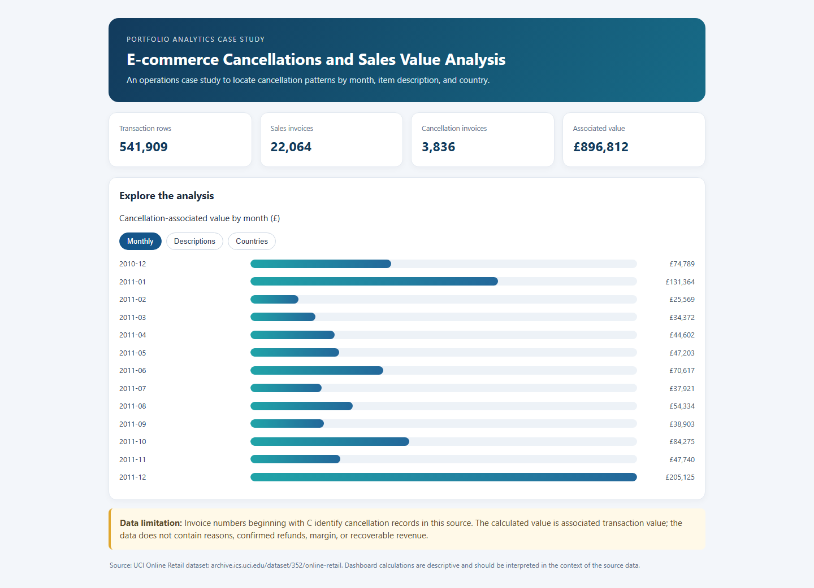

# E-commerce Cancellation and Sales Value Analysis

## Project summary
An online retail operations team wants to know where cancellation records are concentrated by month, item description, and customer country, and how much listed transaction value is associated with those records.

## Business questions
1. How many invoices are marked as cancellations, and how does this vary by month?
2. Which item descriptions and countries account for the largest cancellation-associated values?
3. Are there unusual descriptions that should be checked before operational action?
4. What can the dataset support, and what would the business need to collect next?

## Dataset
`Online_Retail.xlsx` — 541,909 transactions for a UK-based online retailer from 1 December 2010 to 9 December 2011. Invoice IDs beginning with `C` mark cancellation records in the UCI data documentation. Source: [UCI Online Retail](https://archive.ics.uci.edu/dataset/352/online-retail), DOI 10.24432/C5BW33, CC BY 4.0.

## Key findings
- The analysis found **3,836 unique cancellation invoices**.
- The absolute line-item value associated with cancellation records totals **£896,812.49**.
- Some high-value descriptions are fees or manual adjustments rather than ordinary products, so item classification needs review.

## Dashboard

[Open the interactive dashboard](https://nilesh581.github.io/ecommerce-cancellation-analysis/dashboard.html). Click the tabs to explore monthly, description, and country breakdowns. The dashboard is self-contained; the source file is `dashboard.html`.

## Methods and limitations
The included Python script uses pandas for data preparation, invoice classification, and aggregation. The £896,812.49 is **associated transaction value**, not confirmed refunds, lost revenue, or recoverable profit. The dataset does not provide cancellation reasons, refund outcomes, product margins, or intervention results.

## Resume bullet
Analyzed 541,909 UCI online retail transactions with Python and pandas; identified 3,836 cancellation invoices with £896.8K in associated line-item value and built a dashboard to compare patterns by month, item description, and country.

## Rebuild the dashboard
Install the dependencies with `python -m pip install pandas openpyxl`, then run `python build_dashboard.py` from this folder. The script reads the included dataset and regenerates `dashboard.html`. (The churn and bank projects only require pandas; openpyxl is needed for the retail Excel dataset.)
